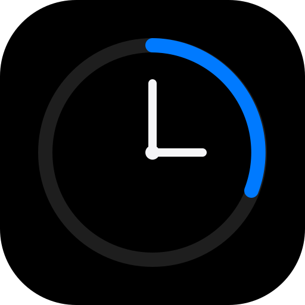

# Shiftly

A sleek, minimalist workday companion and shift tracking application designed for focused professionals. Shiftly keeps you aligned with your daily schedule, tracks remaining shift time with contextual milestones, provides a dedicated Pomodoro focus timer and stopwatch, and offers an ambient full-screen Desk Mode.



---

## ✨ Features

- **Shift Countdown & Overview**: Real-time workday countdown with visual timeline progress, elapsed vs. remaining duration, and smart milestone alerts.
- **Customizable Shifts & Timezones**: Configure your start/end hours, overnight shifts, and target timezone seamlessly.
- **Pomodoro Focus Timer**: Structured work-break sessions with cycle indicators, sound alerts, and configurable durations.
- **Precision Stopwatch**: High-accuracy stopwatch with split lap tracking.
- **Ambient Desk Mode**: Clean, distraction-free full-screen display for your desk or second monitor (press `D` or use the header icon).
- **Audio & System Notifications**: Gentle completion and milestone chimes with optional native browser notifications.
- **Keyboard-Driven Workflow**: Fast shortcuts designed for productivity:
  - `Space`: Pause / Resume timer
  - `R`: Reset active timer
  - `L`: Record lap (Stopwatch)
  - `1`, `2`, `3`: Switch modes (Shift, Pomodoro, Stopwatch)
  - `D`: Toggle full-screen Desk Mode
  - `?`: Open keyboard shortcuts cheat sheet
  - `Esc`: Dismiss overlays / Exit Desk Mode
- **Offline & PWA Ready**: Installable as a Progressive Web App with standalone offline caching.

---

## 🛠 Tech Stack

- **Framework**: [React 19](https://react.dev/)
- **Language**: [TypeScript](https://www.typescriptlang.org/)
- **Bundler & Dev Server**: [Vite](https://vite.dev/)
- **Styling**: Vanilla CSS (zero-dependency design system, glassmorphism, responsive typography)
- **Deployment**: [Vercel](https://vercel.com/) ready with pre-configured `vercel.json`

---

## 🚀 Getting Started

### Prerequisites

- [Node.js](https://nodejs.org/) (version 18+ recommended)
- [npm](https://www.npmjs.com/) (included with Node.js)

### Installation

```bash
# Clone the repository
git clone https://github.com/your-username/shiftly.git
cd shiftly

# Install dependencies
npm install
```

### Development

Run the local development server with Hot Module Replacement (HMR):

```bash
npm run dev
```

The app will start at `http://localhost:5173` (or next available port).

### Production Build

Create an optimized production bundle:

```bash
npm run build
```

The output will be generated in the `dist/` directory. You can preview it locally with:

```bash
npm run preview
```

### Code Quality

Run the linter:

```bash
npm run lint
```

---

## 🌐 Deploying to Vercel

Shiftly includes a pre-configured `vercel.json` for SPA routing and asset caching.

### Option 1: Automatic Deployment via GitHub (Recommended)

1. Push your repository to GitHub:
   ```bash
   git remote add origin https://github.com/your-username/shiftly.git
   git branch -M main
   git push -u origin main
   ```
2. Go to [Vercel](https://vercel.com/) and log in with your GitHub account.
3. Click **Add New Project** and select your `shiftly` repository.
4. Vercel will automatically detect **Vite** as the framework:
   - **Build Command**: `npm run build`
   - **Output Directory**: `dist`
   - **Install Command**: `npm install`
5. Click **Deploy**. Your site will be live on your custom `.vercel.app` URL with automatic SSL and preview deployments on future commits.

### Option 2: Deploy using Vercel CLI

```bash
# Deploy to preview
npx vercel

# Deploy directly to production
npx vercel --prod
```

---

## 📄 License

MIT License. Feel free to use and customize for your workflow!
